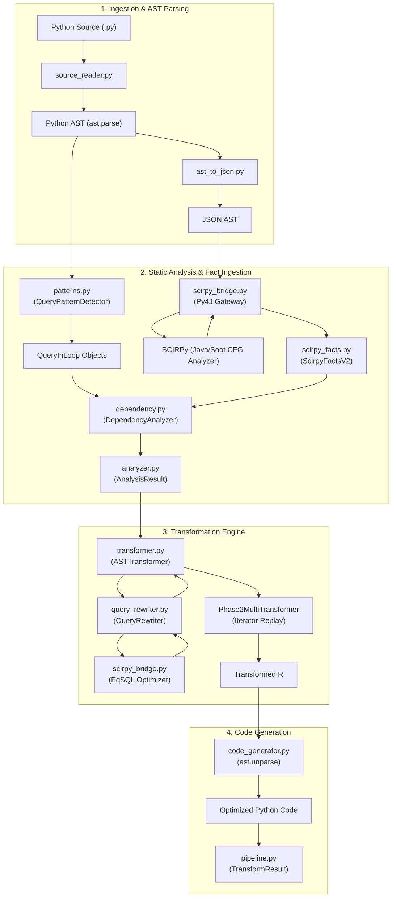
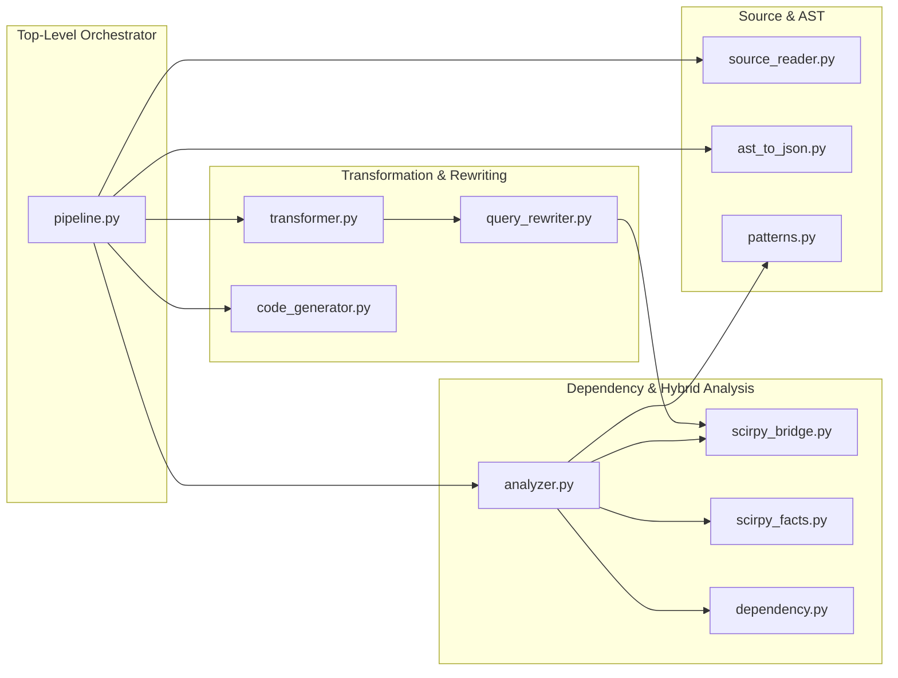

# `py-dbridge` Architecture Guide

`py-dbridge` is a static program analysis and source-to-source transformation framework for Python database applications. Inspired by the foundational research on **DBridge** (*Chavan et al., VLDB 2011*; *Guravannavar & Sudarshan, VLDB 2008*), `py-dbridge` automatically detects imperative database query loops (the classic $N+1$ query antipattern) and rewrites them into efficient **set-oriented, 2-phase batched executions**.

---

## 1. High-Level Architecture Overview & End-to-End Pipeline

### The Problem: Imperative $N+1$ Database Access
In standard procedural code, developers frequently execute parameterized SQL queries inside loops:
```python
for item_id in item_ids:
    cursor.execute("SELECT name, price FROM items WHERE id = %s", (item_id,))
    row = cursor.fetchone()
    process(row)
```
For $N$ items, this code causes $N$ distinct network roundtrips and random disk I/O operations, dominating latency and degrading database scalability.

### The Solution: Holistic Program & Query Transformation
`py-dbridge` transforms iterative code into a **2-Phase Set-Oriented Execution Model**:
1. **Phase 1 (Parameter Batching):** The loop is split. The first phase executes all non-database preparatory statements and collects all parameter bindings into a contiguous batch.
2. **Set-Oriented Query Execution:** A single set-oriented query (`ANY(...)`, `IN (...)`, or EqSQL-optimized join/aggregation) is dispatched to the database. All results are materialized into an in-memory hashed lookup structure (`collections.defaultdict(list)`).
3. **Phase 2 (Result Replay & Stream Processing):** A replay loop traverses the collected context/parameters and feeds the batched results via local iterators into the original downstream computation, preserving the exact imperative semantics, control flow, and order.



---

## 2. Architecture Component Breakdown

All source code resides in [`src/`](src). Below is the breakdown of each core module.



### 1. [`source_reader.py`](src/source_reader.py)
- **Role:** File validation and ingestion.
- **Key Functions:**
  - [`read_source(source: Path) -> str`](src/source_reader.py#L4-L9): Validates that the target path exists and has a `.py` extension, reading its UTF-8 contents.

### 2. [`ast_to_json.py`](src/ast_to_json.py)
- **Role:** AST serialization for cross-language bridge interop.
- **Key Functions:**
  - [`source_to_json(source_code, source_path) -> dict`](src/ast_to_json.py#L6-L9): Parses source text to Python AST and delegates to `ast_to_dict`.
  - [`ast_to_dict(tree: ast.AST) -> dict`](src/ast_to_json.py#L11-L14): Converts AST nodes into serializable dictionaries using [`astexport`](src/astexport/export.py) for ingestion by SCIRPy Java analysis.

### 3. [`patterns.py`](src/patterns.py)
- **Role:** Python AST database query pattern detector.
- **Key Classes & Functions:**
  - [`QueryInLoop`](src/patterns.py#L12-L23): Data container tracking loop nodes, `cursor.execute()` calls, SQL query string, bound parameter names, loop target variable, line number, result dependency status, and DML flags.
  - [`QueryPatternDetector(ast.NodeVisitor)`](src/patterns.py#L24-L158):
    - [`detect(tree) -> list[QueryInLoop]`](src/patterns.py#L33-L35): Walks the AST with a loop stack (`visit_For`, `visit_While`).
    - [`_is_db_execute(node)`](src/patterns.py#L54-L58): Detects calls to `execute` or `executemany`.
    - [`_extract_query_info(node)`](src/patterns.py#L60-L117): Extracts parameter references, identifies DML queries (`INSERT`, `UPDATE`, `DELETE`), and evaluates candidate transformability.
    - [`_has_result_dependency(loop_node, execute_node)`](src/patterns.py#L138-L157): Checks whether subsequent statements consume query outputs via `fetchone()`, `fetchall()`, `fetchmany()`, `lastrowid`, or `rowcount`.

### 4. [`scirpy_bridge.py`](src/scirpy_bridge.py)
- **Role:** Py4J JVM lifecycle management and inter-process gateway communication.
- **Key Functions:**
  - [`_get_gateway()`](src/scirpy_bridge.py#L44-L95): Lazily spawns the SCIRPy JVM process (`PythonGateWay.ScaPaGateway`) via subprocess and connects a Py4J `JavaGateway` on port `25333`.
  - [`_shutdown_gateway()`](src/scirpy_bridge.py#L97-L117): Cleanly tears down gateway connections and kills background JVM processes on process exit (`atexit`).
  - [`run_scirpy_analysis(...) -> dict`](src/scirpy_bridge.py#L120-L195): Passes the JSON AST to SCIRPy Java engine to compute def-use chains, live variables, CFG, and optimal statement ordering.
  - [`eqsql_optimize_query(sql_query, db_type) -> str`](src/scirpy_bridge.py#L197-L215): Dispatches SQL statements to EqSQL inside the JVM for relational unnesting and aggregate rewrite.

### 5. [`scirpy_facts.py`](src/scirpy_facts.py)
- **Role:** Strongly-typed representation of SCIRPy static analysis facts.
- **Key Data Structures:**
  - [`ScirpyQueryFact`](src/scirpy_facts.py#L5-L10): Line numbers, per-statement PRE/EXEC/POST labels, cyclic status, and statement order.
  - [`ScirpyLoopFact`](src/scirpy_facts.py#L12-L20): Head line numbers, loop condition test variables, and query lists.
  - [`ScirpyFactsV2`](src/scirpy_facts.py#L34-L39): Root analysis container holding class/method summaries, loops, dependencies, and typed region trees.
  - [`load_scirpy_facts(analysis_dict) -> ScirpyFactsV2 | None`](src/scirpy_facts.py#L41-L90): Deserializes raw JSON fact dictionaries into typed models.

### 6. [`dependency.py`](src/dependency.py)
- **Role:** Statement data dependency analysis, def-use computation, transitive closure, and loop classification.
- **Key Classes & Functions:**
  - [`Dependency`](src/dependency.py#L10-L16): Represents Read-After-Write (RAW/flow), Write-After-Read (WAR/anti), Write-After-Write (WAW/output), or loop-carried data dependencies.
  - [`DependencyAnalyzer`](src/dependency.py#L18-L278):
    - [`analyze_loop(loop_node) -> list[Dependency]`](src/dependency.py#L21-L50): Identifies dependencies among statements in a loop body.
    - [`classify_loop_stmts(...) -> list[str]`](src/dependency.py#L52-L129): Classifies loop body statements into `PRE` (safe to run before query batching in Phase 1), `ADVANCE` (updates while-condition variables), `EXEC` (query invocation), and `POST` (dependent on query results).
    - [`_find_post_vars(body, execute_node, ...) -> set[str]`](src/dependency.py#L152-L195): Computes the transitive closure of variables influenced by cursor fetch results.
    - [`has_cyclic_dependency(execute_node, body, param_vars, ...) -> bool`](src/dependency.py#L197-L242): Determines if query parameters depend transitively on the query's own results (e.g., hierarchical tree traversal / transitive closure), marking them non-transformable per DBridge correctness proofs.

### 7. [`analyzer.py`](src/analyzer.py)
- **Role:** Hybrid coordinator uniting Python AST analysis with Java SCIRPy static analysis.
- **Key Functions & Classes:**
  - [`AnalysisResult`](src/analyzer.py#L24-L42): Complete analysis state containing candidate queries, data dependencies, transformable queries, statement facts, and reordering directives.
  - [`run_analysis(ast_json, source_path, source_code) -> AnalysisResult`](src/analyzer.py#L60-L169): Detects queries, invokes SCIRPy via py4j, merges external def-use/ordering facts with Python AST analysis, checks for cyclic dependencies, and filters candidate queries.

### 8. [`query_rewriter.py`](src/query_rewriter.py)
- **Role:** Set-oriented SQL transformation, parameter batching, and projection adjustment.
- **Key Classes & Functions:**
  - [`RewriteResult`](src/query_rewriter.py#L14-L41): Holds rewritten SQL, key index, and metadata indicating whether the parameter key was prepended to the `SELECT` list.
  - [`QueryRewriter`](src/query_rewriter.py#L108-L215):
    - [`rewrite_for_batch(sql, param_column, db_type) -> RewriteResult`](src/query_rewriter.py#L111-L215):
      1. Delegates to EqSQL (`eqsql_optimize_query`) for query decorrelation.
      2. Ensures the correlated key is projected in the `SELECT` list (prepending if necessary) so results can be indexed.
      3. Rewrites single-value comparisons:
         - PostgreSQL: `col = %s` $\rightarrow$ `col = ANY(%s)` (or `col = ANY(%(name)s)`)
         - SQLite: `col = ?` $\rightarrow$ `col IN ({})`
      4. Automatically introduces `GROUP BY {param_column}` for scalar aggregate queries (`COUNT`, `SUM`, `AVG`, `MIN`, `MAX`).

### 9. [`transformer.py`](src/transformer.py)
- **Role:** Core AST rewriting engine implementing DBridge 2-phase loop splitting and multi-query batching.
- **Key Classes & Functions:**
  - [`QueryTransformContext`](src/transformer.py#L27-L37): Per-query tracking for parameter variable names (`_pyd_params_{id}`), result map names (`_pyd_result_map_{id}`), iterator names (`_pyd_iter_{id}`), and bound AST arguments.
  - [`Phase2MultiTransformer(ast.NodeTransformer)`](src/transformer.py#L39-L120):
    - Removes `cursor.execute(...)` calls.
    - Replaces `cursor.fetchone()` calls with `next(_pyd_iter_{id}, None)`.
    - Replaces `cursor.fetchall()` calls with `_pyd_result_map_{id}.get(loop_var, [])`.
    - Preserves conditional branching (`visit_If`).
  - [`ASTTransformer(ast.NodeTransformer)`](src/transformer.py#L138-L689):
    - [`_transform_for_multi(loop, queries)`](src/transformer.py#L348-L539): Transforms `for` loops into Phase 1 param collection, batch SQL execution, result map initialization (`collections.defaultdict(list)`), and Phase 2 result replay loop. Handles `executemany` for DML operations.
    - [`_transform_while_multi(loop, queries)`](src/transformer.py#L545-L689): Transforms `while` loops by recording dynamic iteration states into a context list (`_pyd_ctx_{id}`) and replaying results over the captured context.
    - [`_build_execute_and_result_map(...)`](src/transformer.py#L193-L289): Generates batch execute statements and row-grouping loops.
    - [`_reorder_stmts(stmts, stmt_order)`](src/transformer.py#L335-L343): Reorders loop body statements according to SCIRPy dependency analysis.
  - [`apply_transformations(analysis, db_type) -> TransformedIR`](src/transformer.py#L692-L703): Top-level entry point for AST transformation.

### 10. [`code_generator.py`](src/code_generator.py)
- **Role:** Python source code generation from transformed AST.
- **Key Functions:**
  - [`generate_code(transformed_ir) -> str`](src/code_generator.py#L7-L9): Uses standard library `ast.unparse()` to emit clean, formatted Python source code.

### 11. [`pipeline.py`](src/pipeline.py)
- **Role:** Top-level pipeline orchestrator.
- **Key Functions:**
  - [`run_pipeline(source, output, db_type, dry_run) -> TransformResult`](src/pipeline.py#L14-L56): Coordinates source ingestion, AST generation, static analysis, transformation, code generation, import injection (`collections.defaultdict`), and optional file output.

---

## 3. DBridge Paper (Chavan et al., 2011) Feature Mapping

The table below maps the formal transformation rules and capabilities defined in the DBridge literature (*Chavan et al., 2011*; *Guravannavar et al., 2008*) to the exact implementations in `py-dbridge`.

| DBridge Core Feature | Paper Description & Semantics | `py-dbridge` Implementation Class / Function | Source File & Line Range |
| :--- | :--- | :--- | :--- |
| **Statement Reordering** | Reorders independent statements in the loop body so that non-database preparatory statements (`PRE`) precede query execution (`EXEC`), enabling loop splitting without breaking data dependencies. | [`DependencyAnalyzer.classify_loop_stmts`](src/dependency.py#L52-L129)<br/>[`ASTTransformer._reorder_stmts`](src/transformer.py#L335-L343)<br/>[`ASTTransformer._get_stmt_order`](src/transformer.py#L315-L333) | [`dependency.py:52-129`](src/dependency.py#L52-L129)<br/>[`transformer.py:315-343`](src/transformer.py#L315-L343) |
| **Loop Splitting** *(Phase 1 & Phase 2)* | Splits a single loop into: (1) a parameter batch collection loop, (2) batched query execution, and (3) a result processing replay loop. | [`ASTTransformer._transform_for_multi`](src/transformer.py#L348-L539)<br/>[`ASTTransformer._transform_while_multi`](src/transformer.py#L545-L689)<br/>[`Phase2MultiTransformer`](src/transformer.py#L39-L120) | [`transformer.py:348-539`](src/transformer.py#L348-L539)<br/>[`transformer.py:545-689`](src/transformer.py#L545-L689)<br/>[`transformer.py:39-120`](src/transformer.py#L39-L120) |
| **Set-Oriented Query Rewriting** | Rewrites parameterized queries from single-row scalar predicates to set-oriented predicates (`ANY`, `IN`, `GROUP BY`, and decorrelated EqSQL joins). | [`QueryRewriter.rewrite_for_batch`](src/query_rewriter.py#L111-L215)<br/>[`RewriteResult`](src/query_rewriter.py#L14-L41)<br/>[`eqsql_optimize_query`](src/scirpy_bridge.py#L197-L215) | [`query_rewriter.py:111-215`](src/query_rewriter.py#L111-L215)<br/>[`scirpy_bridge.py:197-215`](src/scirpy_bridge.py#L197-L215) |
| **Conditional Block & Guard Handling** | Preserves branch conditions (`if-then-else`) around query execution by evaluating guards in Phase 1 (only batching if true) and retaining control structures in Phase 2. | [`ASTTransformer._transform_for_multi`](src/transformer.py#L428-L434)<br/>[`Phase2MultiTransformer.visit_If`](src/transformer.py#L52-L67) | [`transformer.py:428-434`](src/transformer.py#L428-L434)<br/>[`transformer.py:478-487`](src/transformer.py#L478-L487)<br/>[`transformer.py:52-67`](src/transformer.py#L52-L67) |
| **Loop Context Tracking** *(LoopContextTable)* | For dynamic loops (`while`) where iteration paths depend on state, an ordered context table (`_pyd_ctx_*`) records iteration states during Phase 1 for replay in Phase 2. | [`ASTTransformer._transform_while_multi`](src/transformer.py#L573-L601)<br/>[`ASTTransformer._ctx_append`](src/transformer.py#L306-L313) | [`transformer.py:573-601`](src/transformer.py#L573-L601)<br/>[`transformer.py:622-687`](src/transformer.py#L622-L687) |
| **Cyclic Dependency & Transitive Closure** | Identifies transitive dependencies where query parameters depend on query results (e.g. recursive graph traversals), safely preserving original loop execution. | [`DependencyAnalyzer.has_cyclic_dependency`](src/dependency.py#L197-L242)<br/>[`DependencyAnalyzer._find_post_vars`](src/dependency.py#L152-L195)<br/>[`analyzer.run_analysis`](src/analyzer.py#L114-L125) | [`dependency.py:152-242`](src/dependency.py#L152-L242)<br/>[`analyzer.py:114-125`](src/analyzer.py#L114-L125) |
| **Multi-Query Loops & DML Batching** | Handles loops containing multiple SELECT queries or batched DML operations (`INSERT`/`UPDATE`/`DELETE`), mapping DML to `cursor.executemany(...)`. | [`ASTTransformer.queries_by_loop`](src/transformer.py#L151-L155)<br/>[`ASTTransformer._transform_for_multi`](src/transformer.py#L380-L418)<br/>[`QueryInLoop.is_dml`](src/patterns.py#L22) | [`transformer.py:151-155`](src/transformer.py#L151-L155)<br/>[`transformer.py:380-418`](src/transformer.py#L380-L418)<br/>[`patterns.py:22, 99-106`](src/patterns.py#L99-L106) |

---

## 4. Concrete Transformation Walkthroughs (Before vs. After)

### Scenario 1: For-Loop with Single-Row `SELECT` (PostgreSQL)

#### Before Transformation (Imperative $N+1$)
```python
results = []
for product_id in product_ids:
    cursor.execute("SELECT name, price FROM products WHERE id = %s", (product_id,))
    row = cursor.fetchone()
    if row:
        results.append({"name": row[0], "price": row[1]})
```

#### Transformation Steps Applied by `py-dbridge`:
1. **Key Projection Injection & SQL Rewrite:** `SELECT name, price` is rewritten to `SELECT id, name, price FROM products WHERE id = ANY(%s)`. The correlation parameter `id` is prepended at index 0.
2. **Phase 1 Parameter Batching:** Creates `_pyd_params_1 = [product_id for product_id in product_ids]`.
3. **Set-Oriented Query & Map Construction:** Dispatches the batch query and builds `_pyd_result_map_1 = collections.defaultdict(list)` indexed by `row[0]`, slicing the payload to `row[1:]`.
4. **Phase 2 Iterator Replay:** Replaces `cursor.fetchone()` with `next(_pyd_iter_1, None)`.

#### After Transformation (Set-Oriented 2-Phase Execution)
```python
import collections

results = []
_pyd_params_1 = [product_id for product_id in product_ids]
cursor.execute('SELECT id, name, price FROM products WHERE id = ANY(%s)', (_pyd_params_1,))
_pyd_result_map_1 = collections.defaultdict(list)
for row in cursor.fetchall():
    _pyd_result_map_1[row[0]].append(row[1:])
for product_id in product_ids:
    _pyd_iter_1 = iter(_pyd_result_map_1.get(product_id, []))
    row = next(_pyd_iter_1, None)
    if row:
        results.append({'name': row[0], 'price': row[1]})
```

---

### Scenario 2: Guarded Multi-Query Loop with Aggregate & DML

#### Before Transformation
```python
for item_id, qty in items:
    if qty > 0:
        cursor.execute("SELECT count(order_id) FROM orders WHERE item_id = %s", (item_id,))
        count_row = cursor.fetchone()
        
        cursor.execute("UPDATE inventory SET reserved = reserved + %s WHERE item_id = %s", (qty, item_id))
```

#### After Transformation
```python
import collections

_pyd_params_1 = []
_pyd_params_2 = []
for item_id, qty in items:
    if qty > 0:
        _pyd_params_1.append(item_id)
        _pyd_params_2.append((qty, item_id))

cursor.execute('SELECT item_id, count(order_id) FROM orders WHERE item_id = ANY(%s) GROUP BY item_id', (_pyd_params_1,))
_pyd_result_map_1 = collections.defaultdict(list)
for row in cursor.fetchall():
    _pyd_result_map_1[row[0]].append(row[1:])
cursor.executemany('UPDATE inventory SET reserved = reserved + %s WHERE item_id = %s', _pyd_params_2)

for item_id, qty in items:
    _pyd_iter_1 = iter(_pyd_result_map_1.get(item_id, []))
    if qty > 0:
        count_row = next(_pyd_iter_1, None)
```

---

### Scenario 3: While-Loop with Dynamic Iteration & Context Table

#### Before Transformation
```python
curr = start_id
while curr != -1:
    cursor.execute("SELECT name, next_id FROM nodes WHERE id = %s", (curr,))
    row = cursor.fetchone()
    if row:
        print(row[0])
        curr = row[1]
    else:
        curr = -1
```

> [!NOTE]
> When `curr` is updated directly from `row[1]` (query output), [`DependencyAnalyzer.has_cyclic_dependency`](src/dependency.py#L197-L242) detects a loop-carried RAW cyclic dependency on query results (transitive closure). `py-dbridge` correctly marks this query as non-transformable, preserving original iterative execution without semantic corruption.
