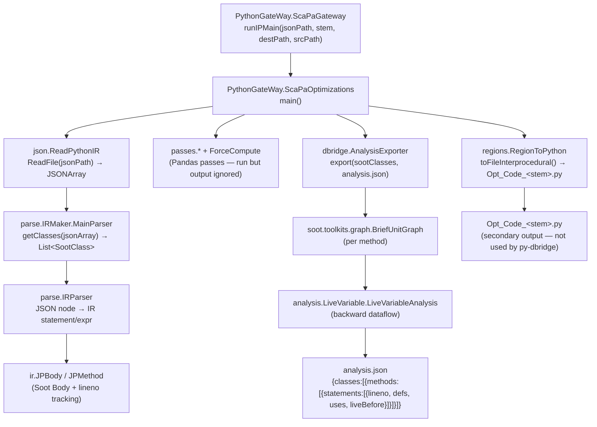

# SCIRPy

> **Purpose**: Quick-start guide for any agent or developer who needs to understand, maintain, or extend the SCIRPy Java component inside `py-dbridge`. After reading this document you should be able to: trace the full execution path, know which files to edit for any common task, and safely ignore everything else.

---

## What SCIRPy Is

SCIRPy (Static Code IR for Python) is a Java static-analysis tool that:

1. Accepts a **Python AST serialized as JSON** as input.
2. Parses the JSON into a **Soot-based intermediate representation (IR)**.
3. Runs **dataflow analysis** (live variables, definition-use chains) over the IR.
4. (Originally) rewrites the IR back to optimized Python for Pandas workloads.
5. (For py-dbridge) exports the analysis results to **`analysis.json`** via Py4J.

The original SCIRPy was a Pandas performance optimizer (drop-column propagation, join rewrites, etc.). `py-dbridge` repurposes it as a **static analysis backend** for SQL-loop transformation.

---

## Repository Layout

```
scirpy/
├── lib/                        # All JARs (soot-trunk, py4j, json-simple, …)
├── out/                        # gitignored Java build output (regenerated by javac/jar)
│   ├── artifacts/scirpy_jar/   # scirpy.jar  ← the runnable artifact
│   └── production/parsePythonIR/ ← compiled .class files
├── parsePythonIR/
│   └── src/                    # ALL Java source lives here
│       ├── PythonGateWay/      ★ ENTRY POINT
│       ├── json/               ★ JSON reader
│       ├── parse/              ★ JSON → IR parser
│       ├── ir/                 ★ IR type hierarchy
│       ├── cfg/                ★ Control-flow graph
│       ├── analysis/           ★ Dataflow analyses
│       ├── dbridge/            ★ py-dbridge addition: analysis exporter
│       ├── passes/             ✗ Pandas passes (not used by py-dbridge)
│       ├── rewrite/            ✗ Pandas rewrite helpers (not used)
│       ├── regions/            ✗ IR→Python writer (not used by py-dbridge)
│       ├── eqsql/              △ SQL/query subsystem (~174 files); not exercised at runtime (see note below)
│       ├── ForceCompute/       ✗ DataFrame force evaluation (not used)
│       ├── DataFileAnalysis/   ✗ Data-file-specific analysis (not used)
│       ├── ast/                △ AST node types (partially used)
│       ├── soot/               △ Soot extension helpers
│       └── internal/           △ Misc utilities
```

**Legend:** ★ = essential, ✗ = not needed for py-dbridge, △ = indirectly used

---

## Execution Flow (End-to-End)



---

## Package-by-Package Reference

### ★ `PythonGateWay` — Entry Point

| File | Role |
|---|---|
| `ScaPaGateway.java` | Py4J `GatewayServer`. Exposes `runIPMain()`. Returns path to `analysis.json`. |
| `ScaPaOptimizations.java` | Orchestrator. Calls ReadPythonIR → MainParser → passes → RegionToPython → AnalysisExporter. |

**Key method:**
```java
// ScaPaGateway.java
public String runIPMain(String sourceNameFull, String sourceFileName,
                        String destinationPath, String dataPath) {
    ScaPaOptimizations.setPaths(sourceNameFull, sourceFileName, destinationPath, dataPath);
    ScaPaOptimizations.main(null);
    return destinationPath + "/analysis.json";   // ← returned to Python
}
```

**Compile & launch:** (no wrapper script — `compile.sh` was removed; run these commands directly)
```bash
# Compile all Java sources
/Library/Java/JavaVirtualMachines/temurin-8.jdk/Contents/Home/bin/javac \
  -source 1.8 -target 1.8 -cp "scirpy/lib/*" \
  $(find scirpy/parsePythonIR/src -name "*.java") \
  -d scirpy/out/production/parsePythonIR

# Repack jar
cd scirpy/out/production/parsePythonIR
jar uf ../../artifacts/scirpy_jar/scirpy.jar .

# Run the gateway (launched by the external Py4J client)
java -cp "scirpy/out/artifacts/scirpy_jar/*:scirpy/lib/*" PythonGateWay.ScaPaGateway
```

---

### ★ `json` — JSON Ingestion

| File | Role |
|---|---|
| `ReadPythonIR.java` | Opens the `.json` AST file, returns `(JSONArray) codeObj.get("body")`. Single static method. |

SCIRPy consumes a **Python AST serialized as JSON**. The input is the JSON file whose path is passed to `runIPMain` (the `body` array is read by `ReadPythonIR`). The producer of that JSON lives in the Python layer (outside this directory).

---

### ★ `parse` — JSON → IR

This is the largest package (~40 files). Most are small single-purpose parsers delegated to by `IRParser`.

| File | Role |
|---|---|
| `IRMaker/MainParser.java` | Top-level: splits class defs from module-level code. Returns `List<SootClass>`. |
| `IRParser.java` (26 KB) | The core recursive parser. Converts every JSON `ast_type` into IR nodes. |
| `GetAssignmentStatementHelper.java` | Handles `Assign` / `AugAssign` — the most complex case. |
| `IfStmtHelper.java`, `ForStmtHelper.java`, `WhileStmtHelper.java` | Control-flow statement parsers. |
| `SimplifiedIf.java`, `SimplifiedFor.java`, `SimplifiedWith.java` | Simplified wrappers for nested block handling. |
| `FuncDefParser.java`, `ClassDefParser.java` | Function/class body parsers. |
| `ArgParser.java`, `AttributeParser.java`, `BinOpParser.java`, … | Expression sub-parsers (one per Python AST node type). |
| `ops/` | `OpParser.java` — maps Python operator names (`Add`, `Sub`, …) to `ir.expr.OpsType` enum. |
| `buildIR.java` | **Legacy** — superseded by `IRParser.java`. Do not use. |
| `StudentResult.py` | **Leftover test file** — ignore. |

> **Important:** `IRParser` tracks `lineno` from the JSON on every constructed `IStmt`. This is what lets `AnalysisExporter` map Soot units back to Python source lines.

---

### ★ `ir` — Intermediate Representation

| File/Dir | Role |
|---|---|
| `IStmt.java` | Interface: extends Soot `Stmt`, adds `int getLineno()`. Every IR statement implements this. |
| `JPBody.java` | Extends Soot `StmtBody`. Holds the unit chain + locals for one method. |
| `JPMethod.java` | Extends Soot `SootMethod`. Wraps a `JPBody`. |
| `JPAbstractStmt.java` | Base class for all statement types. Stores `lineno`. |
| `JPExpr.java` | Represents any Python expression as a Soot `Value`. |
| `Stmt/` | Concrete statement types: `AssignmentStmtSoot`, `CallExprStmt`, `ReturnStmt`, `IfStmt`, `ForStmt`, `WhileStmt`, etc. |
| `expr/` | Expression sub-types and `OpsType` enum. |
| `IBody.java`, `IMethod.java`, `IFile.java` | Interfaces used during construction. |
| `callgraph/` | Call graph builder — **not used in py-dbridge pipeline** (deferred). |
| `manipulation/`, `util/` | Helper utilities for IR manipulation. |

> **Why `JPBody extends StmtBody` (not `JimpleBody`):** `JimpleBody`'s constructors are package-private in `soot-trunk-1.0.jar`. `StmtBody` has `protected` constructors that cross package boundaries. This was a bug fix applied during py-dbridge integration.

---

### ★ `cfg` — Control Flow Graph

| File | Role |
|---|---|
| `JPUnitGraph.java` | Thin subclass of `soot.toolkits.graph.BriefUnitGraph`. Used internally by some analyses. |
| `CFG.java` | Convenience wrapper: takes a `JPMethod`, builds a `JPUnitGraph`. |
| `ProgramPoint.java` | Represents a point in the CFG (unit + position). |

> **Note:** `AnalysisExporter` uses `soot.toolkits.graph.BriefUnitGraph` directly (not `JPUnitGraph`) to avoid a type incompatibility with `Body` vs `JPBody`.

---

### ★ `analysis` — Dataflow Analyses

| File/Dir | Role |
|---|---|
| `LiveVariable/LiveVariableAnalysis.java` | Backward dataflow analysis (Soot `BackwardFlowAnalysis`). Computes live variables before each unit. Used by `AnalysisExporter`. |
| `LiveVariable/LiveDataFrame.java` | Pandas-specific liveness for DataFrames. Used by the original Pandas passes. |
| `Pandas/` | Pandas-specific analysis (attribute liveness). Not used by py-dbridge. |
| `EquivalentExpression/` | Equivalent expression detection. Not used by py-dbridge. |
| `interprocedural/IPMain.java` | Legacy interprocedural entry point. Not used in current pipeline. |
| `PythonScene.java` | Singleton scene tracking all Soot classes during analysis. |

---

### ★ `dbridge` — py-dbridge Addition

| File | Role |
|---|---|
| `AnalysisExporter.java` | **Added by py-dbridge.** Iterates all `SootClass`es and methods, runs `BriefUnitGraph` + `LiveVariableAnalysis`, exports per-statement `{lineno, defs, uses, liveBefore}` to `analysis.json`. |

**Output schema:**
```json
{
  "classes": [{
    "className": "MainClass",
    "methods": [{
      "methodName": "main",
      "statements": [{
        "lineno": 7,
        "unitString": "SQL_DIR = Path(__file__).with_name('sql')",
        "defs": ["SQL_DIR"],
        "uses": ["Path(__file__).with_name('sql')"],
        "liveBefore": ["SQL_DIR", "connection"]
      }]
    }]
  }]
}
```

---

### ✗ Not Needed for py-dbridge (Safe to Ignore)

| Package | What it does | Why ignored |
|---|---|---|
| `passes/` | Pandas: `DropColumnPass`, `Pd1Pass`, `Pd2Pass`, `LaspRewrites`, `JoinOptimization` | Runs but output not consumed |
| `rewrite/` | Rewrite helpers for Pandas passes | Same |
| `regions/` | `RegionToPython` — rewrites IR back to Python | Produces `Opt_Code_*.py` which py-dbridge no longer uses |
| `eqsql/` | Large SQL-generation/HQL subsystem (~174 files). **Not exercised at runtime** — the Py4J `optimizeQuery` call resolves to `dbridge/eqsql/EqSQLHelper` (a regex stub) and does not use this package. Kept for future query-optimization work. | Not invoked (except the stub entry) |
| `ForceCompute/` | Forces lazy DataFrame evaluation | Runs but output not consumed |
| `DataFileAnalysis/` | Data-file schema analysis | Not called |

> **Note:** `passes/` and `ForceCompute/` still run in `ScaPaOptimizations.main()` but their results are discarded. They cannot be removed without modifying `ScaPaOptimizations.java`.

---

## Entry Points (Public API)

SCIRPy is launched as a Py4J `GatewayServer` (`PythonGateWay.ScaPaGateway`) and driven by an external client (the Python layer, which lives outside this directory). The methods it exposes:

| Method | Signature | What it does |
|---|---|---|
| `runIPMain` | `String runIPMain(String jsonPath, String sourceName, String destPath, String dataPath)` | Runs the full pipeline (read → parse → analyses → export). Writes `analysis.json` and `Opt_Code_<sourceName>.py` into `destPath`, then returns the path to `analysis.json`. |
| `optimizeQuery` | `String optimizeQuery(String sql, String dbType)` | SQL optimization entry point. Currently resolves to `dbridge/eqsql/EqSQLHelper` (a regex-based stub) and returns the SQL unchanged for unsupported forms. |

**Input contract:** a JSON file containing the Python AST (`body` array).
**Output contract:** `analysis.json` with the schema shown in the `dbridge` section above (`{classes:[{methods:[{statements:[{lineno, defs, uses, liveBefore}]}]}]}`).

**Build artifact:** `out/artifacts/scirpy_jar/scirpy.jar` (regenerated via the compile steps above).

---

## Common Maintenance Tasks

### Recompile after editing any Java source
```bash
JAVA8=/Library/Java/JavaVirtualMachines/temurin-8.jdk/Contents/Home/bin
$JAVA8/javac -source 1.8 -target 1.8 -cp "scirpy/lib/*" \
  $(find scirpy/parsePythonIR/src -name "*.java") \
  -d scirpy/out/production/parsePythonIR

cd scirpy/out/production/parsePythonIR
$JAVA8/jar uf ../../artifacts/scirpy_jar/scirpy.jar .
```

### Add a new analysis field to `analysis.json`
Edit **`dbridge/AnalysisExporter.java`** only. Add your field inside the `for (Unit u : body.getUnits())` loop, then recompile.

### Add support for a new Python AST node type
1. Edit **`parse/ops/OpParser.java`** if it's an operator.
2. Edit **`parse/IRParser.java`** for the statement/expression handling.
3. Add a case to the relevant `parse/*StmtHelper.java` or `parse/*Parser.java`.

### Fix a parser crash (NPE / RuntimeException)
Most crashes come from unhandled JSON keys. Start at **`parse/IRParser.java`** and look at the `ast_type` switch. Typical fixes:
- Unhandled `ast_type` → add a case returning a no-op statement.
- Null `key` in `DictParser` → null-check before use (see `DictParser.java`).
- Null `methodName` → guard in `IRParser` (already fixed).

### Debug empty `methods: []` in analysis.json
Means `sm.hasActiveBody()` returned false. Check that `MainParser` actually set an active body (`method.setActiveBody(jpBody)`) for the class/method in question. Trace through `MainParser.getClasses()` → `IRMaker.GetSootClass`.

---

## Files Added / Modified by py-dbridge

| Status | File | Change |
|---|---|---|
| **NEW** | `dbridge/AnalysisExporter.java` | Exports Soot analysis facts to `analysis.json` |
| **MODIFIED** | `PythonGateWay/ScaPaGateway.java` | Return type `String` + returns `analysis.json` path |
| **MODIFIED** | `PythonGateWay/ScaPaOptimizations.java` | Calls `AnalysisExporter.export()` after RegionToPython |
| **MODIFIED** | `ir/JPBody.java` | Extends `StmtBody` instead of `JimpleBody` (cross-package fix) |
| **MODIFIED** | `parse/ops/OpParser.java` | Added `Name`, `UnaryOp`, `Attribute`, `Subscript`, `Call` cases |
| **MODIFIED** | `parse/SimplifiedIf.java` | Removed `System.exit(1)` on non-Compare test, returns `test` directly |
| **MODIFIED** | `parse/AttributeParser.java` | Added `ListComp` case + null check for `**kwargs` |
| **MODIFIED** | `parse/DictParser.java` | Null check for dict unpack (`key == null`) |
| **MODIFIED** | `parse/IRParser.java` | Null checks for `methodName` and `parameterTypes` |
| **MODIFIED** | `ir/expr/OpsType.java` | Added `Is`, `IsNot`, `NotIn` enum values |

---

## Java Version Constraint

> **Must use Java 8.** `soot-trunk-1.0.jar` in `scirpy/lib/` was compiled targeting Java 8. Using Java 17+ causes `IllegalAccessError` and `InaccessibleObjectException` in Soot internals.

Run with `JAVA_HOME` pointing at a Java 8 JDK; the gateway/classpath is configured by the external client that launches SCIRPy.
